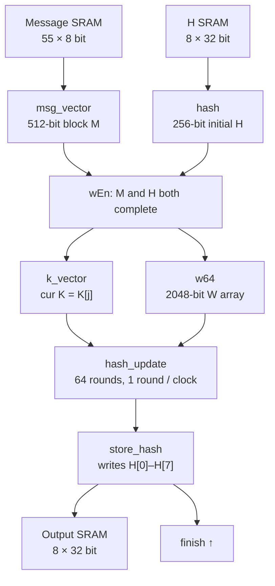
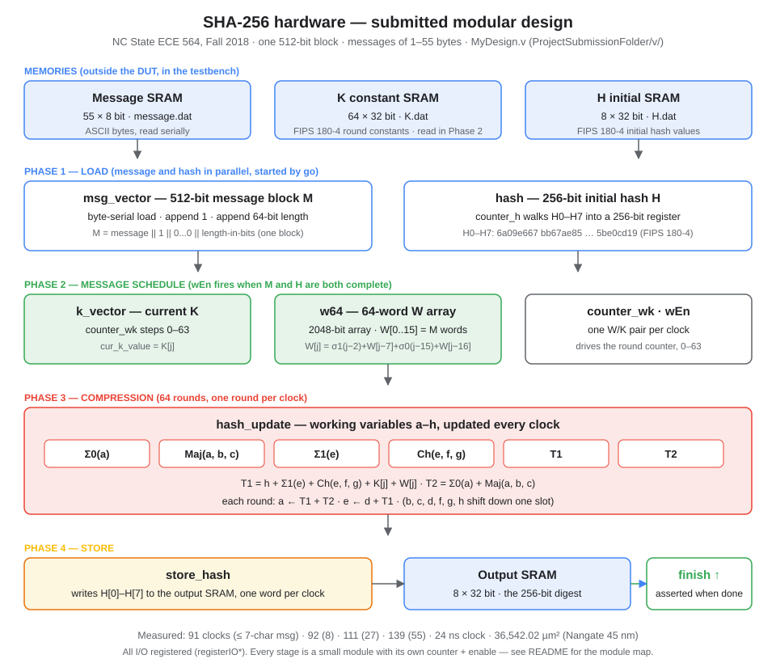
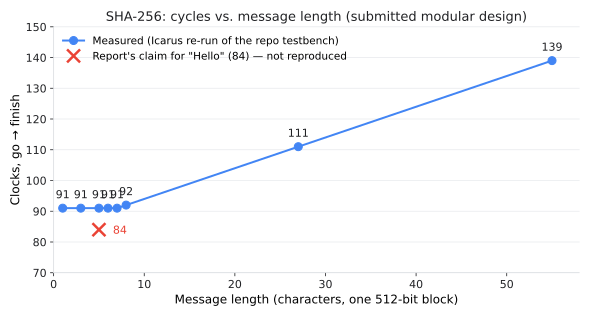
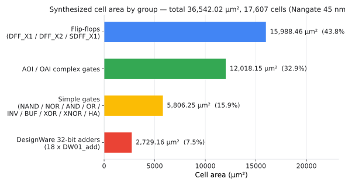
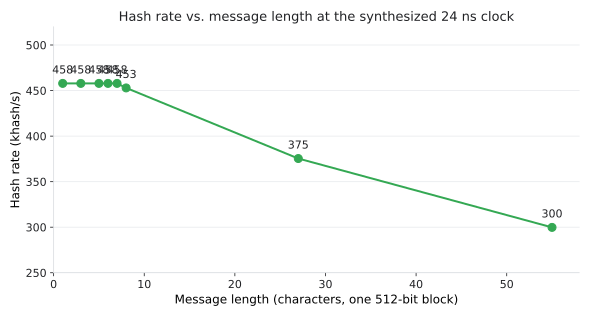

# SHA-256 in Verilog

A hardware implementation of the **SHA-256** hash function, written in Verilog.
Feed it a message of 1–55 ASCII characters and it returns the 256-bit digest —
one 512-bit block, 64 compression rounds, no padding across blocks (a message
this short always fits in a single block).

Course project — **NC State ECE 564, Fall 2018 (Franzon): SHA-256** (ECE 564-001
does the full hash; ECE 464 / ECE 564-601 students stop at the M_1 array).
The assignment spec is in [`ProjectsTechnicalF18.pdf`](ProjectsTechnicalF18.pdf),
the general project instructions in [`Project_general.pdf`](Project_general.pdf),
and the submitted write-up in
[`ProjectSubmissionFolder/report/project_report.pdf`](ProjectSubmissionFolder/report/project_report.pdf).

## Two versions in this repo — read this first

This repo contains **two different implementations** of the same design, and
they are not equivalent:

| | Submitted design (verified) | Working-copy rewrite (broken) |
|---|---|---|
| File | `ProjectSubmissionFolder/v/MyDesign.v` | `projectSHA/MyDesign.v` |
| Style | Modular — 19 modules in one file | Flat — one 712-line module |
| History | Simulated + synthesized Dec 3, 2018 | Reworked Jan 2019, after submission |
| Rounds | 1 round per clock | 1 round per 4 clocks |
| W array | Full 64-word (2048-bit) register array | 16-word sliding window |
| Status | **Correct** — re-verified Nov 18, 2026 (see below) | **Does not work** — wrong digest for short messages, hangs for 9/17/27/55-char messages |

The README below describes the **submitted modular design**, because that is
the one with simulation transcripts, synthesis reports and a correct hash.
The flat rewrite in `projectSHA/` is the repo's working copy and the version
the old README points at — but re-running it under Icarus Verilog shows it
never produces a correct digest (see [Verification](#verification)). If you
simulate this repo, simulate the submitted version.

## How SHA-256 works here

SHA-256 (FIPS 180-4) pads the message to a multiple of 512 bits, splits it
into 32-bit words, expands those into a 64-word schedule, then runs 64
compression rounds over eight 32-bit working variables. Because the project
limits messages to 55 bytes, there is always exactly **one** 512-bit block:

```
M = message || 1 || 0...0 || length-in-bits (64-bit)
```

The message schedule and the compression round use these functions
(all arithmetic is mod 2³²):

| Function | Definition |
|---|---|
| Ch(x, y, z) | (x ∧ y) ⊕ (¬x ∧ z) |
| Maj(x, y, z) | (x ∧ y) ⊕ (x ∧ z) ⊕ (y ∧ z) |
| Σ0(x) | ROTR²(x) ⊕ ROTR¹³(x) ⊕ ROTR²²(x) |
| Σ1(x) | ROTR⁶(x) ⊕ ROTR¹¹(x) ⊕ ROTR²⁵(x) |
| σ0(x) | ROTR⁷(x) ⊕ ROTR¹⁸(x) ⊕ SHR³(x) |
| σ1(x) | ROTR¹⁷(x) ⊕ ROTR¹⁹(x) ⊕ SHR¹⁰(x) |
| W[j], j = 0..15 | M words |
| W[j], j = 16..63 | σ1(W[j−2]) + W[j−7] + σ0(W[j−15]) + W[j−16] |
| T1 | h + Σ1(e) + Ch(e, f, g) + K[j] + W[j] |
| T2 | Σ0(a) + Maj(a, b, c) |

Each round: `a ← T1 + T2`, `e ← d + T1`, and (b, c, d, f, g, h) shift down
one slot. After round 63 the initial hash values are added back:
`H[i] ← H[i] + working variable`. The constants K[0..63] and the initial
H[0..7] are the FIPS 180-4 values, loaded from `K.dat` / `H.dat` — both
files were checked word-for-word against the standard (see
[Verification](#verification)).

## Architecture





### The four phases

1. **Load (message and hash in parallel).** On `go`, the `go`/`msgEn`
   enables start two counters. `counter` walks the message bytes out of the
   message SRAM while `msg_vector` assembles the 512-bit block: message
   bytes first, then the `1` bit, then zeros, then the 64-bit bit-length.
   In parallel, `counter_h` walks H0–H7 out of the H SRAM while `hash`
   assembles the 256-bit initial hash vector. Message and hash loading
   overlap, so short messages cost the same as an 8-byte one — the
   measured totals follow clocks = 84 + max(message length, 7).
2. **Message schedule.** `wEn` fires when both vectors are complete.
   `counter_wk` steps 0–63; each clock `k_vector` presents the next round
   constant K[j] and `w64` presents the next schedule word W[j]. The first
   16 words are the message block itself; words 16–63 are computed on the
   fly from earlier words with the σ0/σ1 recurrence and stored in the
   2048-bit W array.
3. **Compression.** `hash_update` runs one full round per clock:
   Σ0/Σ1/Ch/Maj/T1/T2 are combinational from the registered a–h working
   variables, and the updated a–h are registered for the next round. On the
   64th round the initial H values are added back into the result.
4. **Store.** `store_hash` writes the eight 32-bit digest words to the
   output SRAM, one per clock, then asserts `finish`. The design is then
   ready for another `go`. The testbench pulses `go` three times per run,
   but the third pulse lands while the second run is still going and is
   ignored (the report §5 notes this), so two results are stored
   (`result_0.txt`, `result_1.txt`).

Every input and output passes through a `registerIO*` register, so the DUT
presents registered I/O to the SRAMs. There is no explicit FSM: each stage
is a small module with its own counter and a sticky enable (`go` /
`msgEn` / `wEn`), and the stages hand off through `*_complete` flags.

### Module map (`ProjectSubmissionFolder/v/MyDesign.v`, 1,126 lines)

| Module | What it does |
|---|---|
| `MyDesign` | Top level: the course-specified port list, all I/O registered, submodules wired together |
| `go`, `msgEn`, `wEn` | Sticky enables: set on `go` (or on both inputs complete), cleared on `finish` / reset |
| `registerIO1/3/6/8/32` | 1/3/6/8/32-bit input/output registers |
| `counter`, `counter_h`, `counter_wk`, `counter_hashupdate` | Up-counters for the message (0–54), hash (0–7) and W/K (0–63) indexes |
| `msg_vector` | Builds the 512-bit message block M (bytes + `1` + zeros + length) |
| `hash` | Builds the 256-bit initial hash vector from the H SRAM |
| `k_vector` | Presents the current round constant K[j] |
| `w64` | The 64-word W array (2048-bit register) and the σ0/σ1 expansion |
| `hash_update` | The compression round: Σ0/Σ1/Ch/Maj/T1/T2, a–h update, final H addition |
| `store_hash` | Writes H[0]–H[7] to the output SRAM and raises `finish` |

The testbench (`ece564_project_tb_top.v`, course-supplied) instantiates four
` sram` memories (message, K, H, output), pulses `go`, counts the clocks
until `finish`, prints the digest words, and writes `result_0.txt` /
`result_1.txt` from the output memory. `sram.v` is the course-supplied
generic SRAM (Lee Baker, NCSU, Oct 2017).

## Build and run

### Original flow (ModelSim, as submitted)

```sh
cd projectSHA            # or ProjectSubmissionFolder/v
vlog -sv sram.v
vlog -sv MyDesign.v
vlog -sv ece564_project_tb_top.v
vsim -novopt tb_top      # or: vsim -c -do "run -all; quit" tb_top
```

### Re-run with Icarus Verilog (what the verification below used)

The course `sram.v` uses a SystemVerilog associative array
(`bit [DATA_WIDTH-1:0] mem [int]`), which Icarus Verilog does not support.
The re-runs below used a functionally equivalent drop-in SRAM model
(same read/write timing, same `@address data` file loading) kept outside
the repo; the DUT and testbench files are the repo's own, unmodified.

```sh
# 1. pick a message: copy one of the example files to message.dat
cp message_eq_abc.dat message.dat        # "abc" (3 chars)
#    (message_eq_hello.dat holds lowercase "hello"; message.dat holds "Hello")

# 2. set the message length in the testbench (characters, not bits)
#    ece564_project_tb_top.v, line 15: `define MSG_LENGTH 3

# 3. compile and run (submitted modular design)
iverilog -g2012 -o sim.vvp sram.v MyDesign.v ece564_project_tb_top.v
vvp sim.vvp
```

The testbench prints `Hash[0] … Hash[7]` twice (it runs the DUT twice) and
writes `result_0.txt` and `result_1.txt`. It also prints the go→finish
clock count — under Icarus that counter never fires (a posedge race on the
1-cycle `go` pulse), so the counts in the table below were measured with
an equivalent harness that drives `go` from the negedge; the counts match
the 2018 ModelSim transcript exactly.

### Expected digest for a message (Python reference)

```sh
cd pythonScript
python3 sha256Verification.py --job custom --input Hello
# prints the padded block, all 64 W words, all 64 rounds, then:
#   sha256 result:    185f8db32271fe25f561a6fc938b2e264306ec304eda518007d1764826381969
#   reference result: 185f8db32271fe25f561a6fc938b2e264306ec304eda518007d1764826381969
#   The results match
# (Python 2: use sha256VerificationPython2.py. The script also writes
#  message.dat for the input, ready to copy into the Verilog folder.)
```

## Verification

Re-verified **November 18, 2026** with Icarus Verilog 12.0, using the
repo's own testbench and its own message files. Every digest below was
compared against Python's `hashlib.sha256`.

### Functional results — submitted modular design

| Message | Length | Clocks (go → finish) | Digest matches `hashlib.sha256` |
|---|---|---|---|
| `a` | 1 | 91 | ✅ `ca978112…afee48bb` |
| `abc` | 3 | 91 | ✅ `ba7816bf…f20015ad` |
| `Hello` | 5 | 91 | ✅ `185f8db3…26381969` |
| `AAAAAA` | 6 | 91 | ✅ `69dc6c32…cb389f30` |
| `message` | 7 | 91 | ✅ `ab530a13…460c6d1d` |
| `AAAAAAAA` | 8 | 92 | ✅ `c34ab6ab…e212385` |
| `abcdefghijklmnopqrstuvwxyzA` | 27 | 111 | ✅ `3b6bd6f4…2ef04a4` |
| `abcdefghijklmnopqrstuvwxyzABCDEFGHIJKLMNOPQRSTUVWXYZ012` | 55 | 139 | ✅ `d74ba075…daef326` |

Full digests are in [`docs/cycles-data.csv`](docs/cycles-data.csv).
Cycle law from the measurements: **clocks = 84 + max(message length, 7)** —
the message/hash load takes `max(length, 8)` clocks, then 64 rounds, 8
store clocks and the pipeline overhead make up the rest. The 2018 ModelSim
transcript in `ProjectSubmissionFolder/result/transcript` shows the same
counts for the TA's secret messages (91 / 111 / 139 clocks for the 1-,
27- and 55-character inputs), so the re-run reproduces the original
simulation exactly.



**One claim did not reproduce.** The project report (§6) and
`result.txt` both say the "Hello" hash takes **84 cycles**. Measured with
the testbench's own counter — in 2018 (transcript) and in the 2026 re-run —
"Hello" takes **91 cycles**; 84 is the fixed overhead term in the cycle
law above, not the total for any message. The performance number below
therefore uses the measured 91 cycles; the report's 84-cycle figure is flagged under Known issues below.

### Constants and reference outputs

| Check | Result |
|---|---|
| `H.dat` (8 words) vs FIPS 180-4 initial hash values | ✅ all 8 match |
| `K.dat` (64 words) vs FIPS 180-4 round constants | ✅ all 64 match |
| `pythonScript/sha256Verification.py --job custom --input Hello` vs `hashlib` | ✅ `185f8db3…26381969`, "The results match" |
| Checked-in `result_0.txt` / `result_1.txt` vs `hashlib.sha256("Hello")` | ✅ identical, all 8 words |
| `message_eq_abc.dat` / `message_eq_hello.dat` / `message_eq_message.dat` contents | ⚠️ files hold `abc`, `hello`, `message` (all lowercase) — the README's "Hello"/"Message" is wrong on case |

### Synthesis results (submitted design, Dec 3, 2018)

Synopsys Design Compiler K-2015.06-SP1, Nangate 45 nm Open Cell Library
(`ProjectSubmissionFolder/synth/`, `CLK_PER 24`), reports in
`ProjectSubmissionFolder/result/`.

| Metric | Value | Source |
|---|---|---|
| Cell area | **36,542.02 µm²** (17,607 cells) | `cell_report_final.rpt` |
| Clock period | **24 ns** | `setup.tcl`, timing reports |
| Worst setup slack (slow corner) | **+0.3905 ns** (MET) | `timing_max_slow.rpt` |
| Slack after hold fixing | **+0.4543 ns** (MET) | `timing_max_slow_holdfixed_test.rpt` |
| Hold slack (fast corner) | **+0.0116 ns** (MET) | `timing_min_fast_holdcheck_test.rpt` |
| Critical path | `wBlock/w_vector_index2_reg[2]` → `wBlock/w_vector_reg[575]` (23.20 ns) | `timing_max_slow.rpt` |
| Performance number, area × cycles × clock | **7.98 × 10⁷ µm²·ns** (36,542.02 × 91 × 24) | derived from measured cycles |
| Performance number as reported | 7.3 × 10⁷ µm²·ns (36,543.08 × 84 × 24) | `result.txt` — uses the unreproduced 84-cycle figure |

The report's `1/(delay·area)` figure (1.14024 × 10⁻⁶) uses the 24 ns
clock period as "delay", not the 84 × 24 = 2016 ns run time (which would
give 1.357 × 10⁻⁸) — see Known issues below.

Flip-flops dominate the area (3,339 DFFs, 43.8%), followed by AOI/OAI
complex gates (32.9%) — the wide muxes that build the 512-bit message
vector and the 2048-bit W array. The 18 DesignWare 32-bit adders
(T1/T2/W-expansion) are 7.5%.





Hash rate at the 24 ns clock: **458 khash/s** for messages up to 7
characters (one 512-bit block per 91 clocks), **453 khash/s** for an
8-character message (92 clocks), falling to **300 khash/s** for a
55-character message (139 clocks) — the block rate is fixed per run, so
longer messages amortize the same 512-bit block over more input bytes
but cost extra load clocks.

### The flat rewrite does not work (projectSHA/MyDesign.v)

Re-running the Jan 2019 flat rewrite with the same harness and the same
messages:

| Message length | Result |
|---|---|
| 1, 3, 5, 7, 8, 16, 20 | `finish` asserts (156–168 clocks) but the output memory holds `00000000` / `xxxxxxxx` — wrong digest |
| 9, 17, 27, 55 | `finish` never asserts (timeout at 100,000 clocks) |

Likely causes, from reading the code (not from a waveform debug): `finish`
is driven from **two** `always @(posedge clk)` blocks (lines 81 and 709);
`domData` is driven from **eight** generated `always` blocks (one per
output word); and the W schedule overwrites W[0..15] with speculatively
computed `new_w` values whose σ indices wrap for rounds 0–15. Multiple
drivers make the result depend on simulator scheduling and are illegal
for synthesis. This version was never part of the submission and has no
simulation transcript in the repo.

## Repository layout

```
README.md / README                 original (course) readmes — brief run instructions
ECE564_SHA256_Plan.pdf             project plan (schedule + risk plan, /10)
Project_general.pdf                general ASIC project instructions (Franzon)
ProjectsTechnicalF18.pdf           the project spec (ECE 464/564, Fall 2018)
ProjectSubmissionFolder/
    report/project_report.pdf      submitted write-up (Vishal Ganesh Shitole, vgshitol)
    v/                             SUBMITTED Verilog: MyDesign.v, ece564_project_tb_top.v,
                                   sram.v, H.dat, K.dat, message.dat, modelsim.ini
    synth/                         Synopsys DC scripts (setup/read/compile/constraints)
    result/                        simulation transcript, result_0/1.txt, timing + cell
                                   reports, synthesized netlist MyDesign_final.v
projectSHA/                        working copy: flat MyDesign.v rewrite (Jan 2019),
                                   testbench, K/H/message .dat files, synth scripts,
                                   .bak files, modelsim.ini
pythonScript/                      sha256Verification.py (Py3) / sha256VerificationPython2.py
                                   + README; generates digests and message.dat files
docs/                              architecture.svg + charts (this refresh)
```

Other branches: `Synthesis` is a side branch with intermediate
`SupportingModules/` (`.v`/`.sv` fragments) and ModelSim `work/` artifacts;
it is not the submitted design.

## Known issues and discrepancies

- **84 vs 91 cycles for "Hello"** — report §6 and `result.txt` say 84;
  the 2018 transcript and the 2026 re-run both measure 91 (see
  [Verification](#verification)).
- **Area figures differ slightly by source** — 36,542.01 µm² (report),
  36,543.08 µm² (`result.txt`), 36,542.0166 µm² (cell report). The cell
  report is the primary source; the differences are ~1 µm².
- **Report's `1/(delay·area)`** uses the 24 ns clock period as the delay
  rather than the full 84 × 24 ns run time.
- **Report abstract says "120 cycles"** in one sentence and 84 in the
  results section; neither matches the measured 91 for "Hello". The
  abstract also estimates the area as "around 32,000" µm², against the
  synthesized 36,542 µm².
- **Example message files are lowercase** — `message_eq_hello.dat` holds
  `hello` and `message_eq_message.dat` holds `message`, despite the README
  saying "Hello" / "Message". The current `message.dat` is "Hello"
  (capital H), which matches the report's example and `result_0.txt`.
- **Testbench port-width warning** — the testbench declares
  `xxx__dut__msg_length` as 7 bits while the DUT port is 6 bits
  (ModelSim `vsim-3015` warning in the 2018 transcript; same warning
  under Icarus). Harmless, but the top bit is pruned.
- **Stale files** — `MyDesign.v.bak`, `ece564_project_tb_top.v.bak`
  (the `.bak` testbench has `MSG_LENGTH 1`), `.DS_Store` files, and a
  committed `modelsim.ini`.
- **No LICENSE file.**
- **The flat rewrite is broken** — see above; it should not be presented
  as the design without a fix and a re-run.
